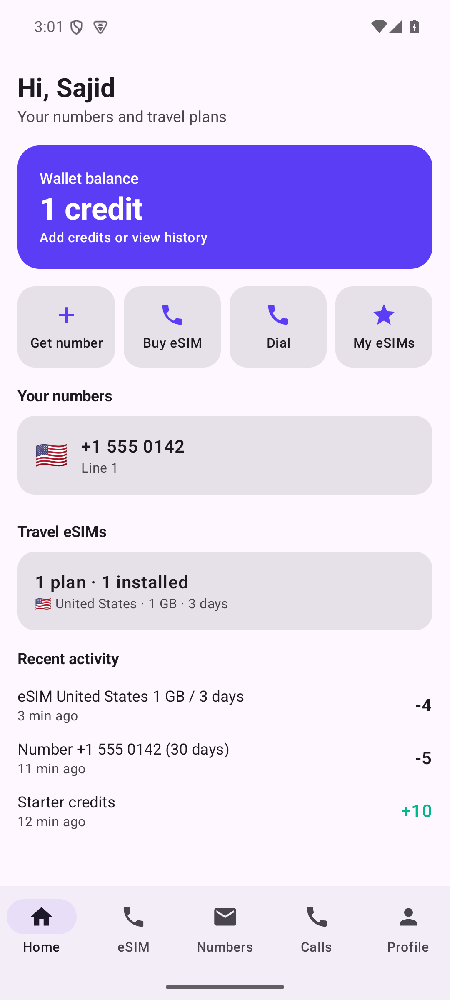
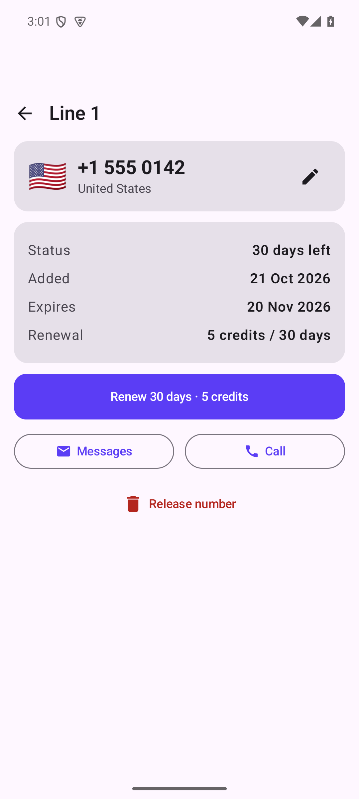
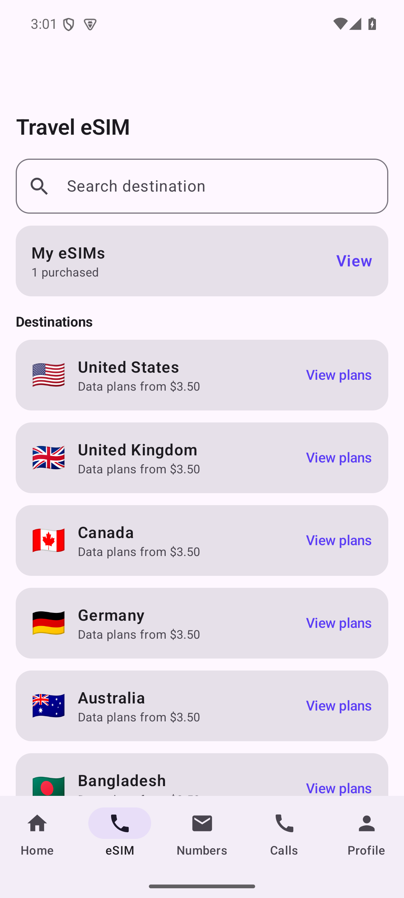
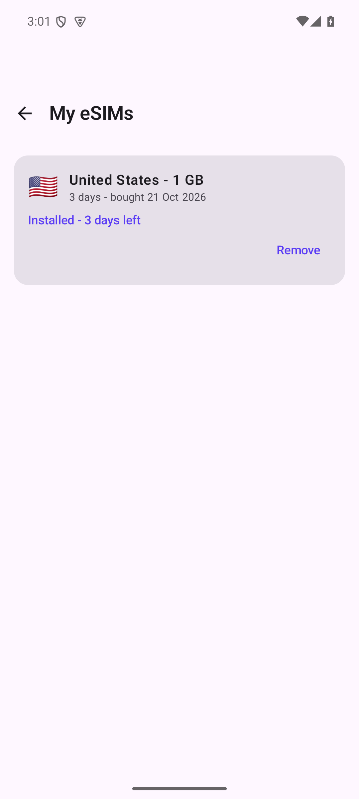
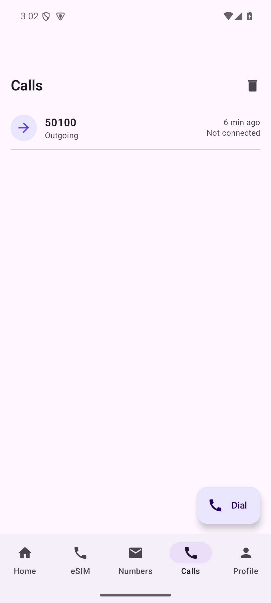
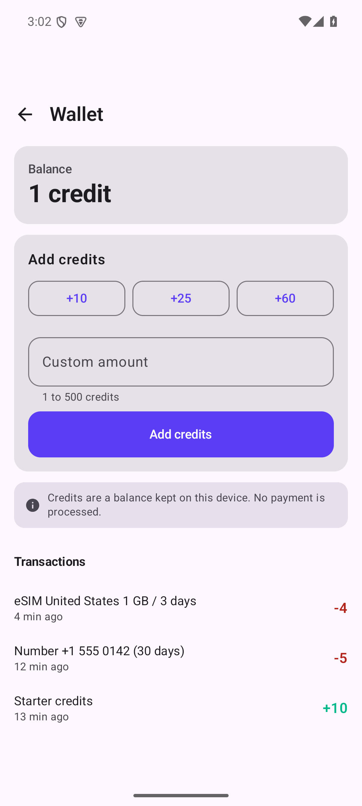
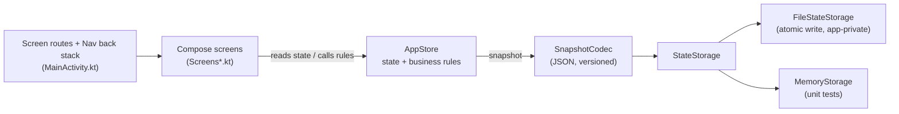

<div align="center">

# Numa

**A native Android app for managing virtual phone numbers and travel eSIM plans from one wallet — built with Kotlin and Jetpack Compose.**


[Overview](#-overview) · [Highlights](#-highlights) · [Preview](#-preview) · [Architecture](#-architecture) · [Tech Stack](#-tech-stack) · [Getting Started](#-getting-started) · [Testing](#-testing) · [Structure](#-project-structure)

</div>

---

## ◈ Overview

Numa brings the everyday tasks of a "second number + data roaming" app into one place: pick a number in
another country, keep conversations per number, place calls from a dialer, buy a travel data plan for your
next trip, and pay for all of it from a single credits wallet.

It is a complete, offline-first client: profiles, numbers, conversations, call history, purchased plans and the
wallet ledger are modelled with real business rules (credit checks, 30-day number terms and renewals,
eSIM validity that starts when you mark a plan installed) and **persisted on the device**, so the app resumes
exactly where you left it.

> **Honest scope.** Numa has no backend and no provider integrations. There is no carrier, SMS gateway,
> VoIP service, payment processor or eSIM provisioning platform behind it, so:
> - numbers, plans and credits are **records kept on this device** — nothing is provisioned or charged;
> - messages are stored locally and **not delivered** over a network;
> - calls end on a clear "not connected" screen and are logged as attempts;
> - eSIM purchases show install steps but issue no real profile.
>
> The Settings → Integrations screen lists these four services as *Not connected*. The domain layer is built so
> real providers can be added behind it (see [Roadmap](#-roadmap)).

## ◈ Highlights

**Virtual numbers** — Browse eight countries, search by name or dial code, pick a number, pay with credits, rename it, renew it, release it. Each number has a 30-day term with a live countdown and an "expiring soon" prompt on Home.

**Messaging** — A conversation per number with unread state, relative timestamps, input validation (empty and 1,000-character limits), delete-with-confirmation, and auto-scroll to the latest message.

**Calling** — Keypad dialer with caller-ID selection from your numbers, `+`/clear long-press shortcuts, number validation, call history with redial and clear-history.

**Travel eSIM** — Destination search, plan comparison (data, validity, USD and credit price), balance-after-purchase preview, install steps, and a *My eSIMs* list where marking a plan installed starts its validity countdown.

**Wallet** — Starter credits, quick-add amounts and a validated custom amount (1–500), and a signed transaction ledger covering every purchase and renewal.

**Persistence & settings** — Everything survives restarts. System / light / dark theme, notification preferences, profile editing, sign-out that keeps your data, and a confirmed *Delete all data*.

## ◈ Preview

| Home | Number | eSIM plans |
|:---:|:---:|:---:|
|  |  |  |

| My eSIMs | Calls | Wallet |
|:---:|:---:|:---:|
|  |  |  |

*Captured from the debug build on an Android emulator.*

## ◈ Architecture

Single-module, single-activity app. Screens are Compose functions; all state and business rules live in one
testable store behind a small storage interface. There is deliberately no DI framework, navigation library
or database dependency.



- **`AppStore`** holds state as Compose snapshot state, so screens recompose automatically. Every rule method
  (`buyNumber`, `renewNumber`, `send`, `buyEsim`, `addCredits`, …) validates input and returns `null` on success or a
  user-facing error string. Lists are exposed as immutable copies; the clock is injectable for tests.
- **Persistence** — each mutation writes the whole state through `StateStorage` as versioned JSON
  (`SnapshotCodec`, `org.json`, no extra dependencies). Writes are atomic (temp file + rename) and corrupt or
  unknown-version files fall back to a clean start. The interface is the seam for a Room database or a remote
  source later.
- **Navigation** — `Screen` is a sealed interface; `Nav` wraps a `SnapshotStateList<Screen>`. The five tabs reset
  the stack, other routes push, and system back is handled with `BackHandler`. Signed-out users are held on the
  welcome flow.
- **UI system** — one theme (`Theme.kt`) with light/dark/system modes and shared components (`ScreenFrame`,
  `AppCard`, `PrimaryButton`, `EmptyState`, `ServiceNotice`, `SectionTitle`) used by every screen.
- **Why no ViewModels yet:** the store is already lifecycle-independent and process-scoped, and screen state is
  trivial. ViewModels become worthwhile once data is loaded asynchronously from a real backend.

Screen map and flows: [`docs/SCREENS.md`](docs/SCREENS.md).

## ◈ Tech Stack

| Layer | Technologies | Purpose |
|---|---|---|
| Language | Kotlin 2.1.0, JDK 17 | App and tests |
| UI | Jetpack Compose (BOM 2024.09.00), Material 3 | Screens, theming, components |
| State | Compose snapshot state | Reactive UI state held in `AppStore` |
| Persistence | `org.json` + atomic file writes | Versioned JSON snapshot in app-private storage |
| Build | Gradle 8.11.1, Android Gradle Plugin 8.7.3 | `minSdk 26`, `targetSdk 35`, `compileSdk 35` |
| Testing | JUnit 4 | Store rules, persistence round-trips, formatting |

## ◈ Getting Started

**Prerequisites:** JDK 17 and an Android SDK with platform 35. Point Gradle at the SDK by creating a
`local.properties` file (it is git-ignored):

```properties
sdk.dir=C\:/path/to/android-sdk
```

**Build the debug APK**

```bash
git clone https://github.com/Saji-d/numa-sim-wallet.git
cd numa-sim-wallet
./gradlew :app:assembleDebug        # Windows: gradlew.bat :app:assembleDebug
```

The APK is written to `app/build/outputs/apk/debug/app-debug.apk`.

**Install and launch**

```bash
adb install -r app/build/outputs/apk/debug/app-debug.apk
adb shell am start -n com.sajid.numa/.MainActivity
```

Or open the folder in Android Studio and press **Run**. No API keys or other configuration are required.

## ◈ Testing

```bash
./gradlew :app:testDebugUnitTest    # 63 JVM unit tests, no device needed
./gradlew :app:lintDebug            # Android lint
```

Current results: **63 of 63 unit tests pass**; lint reports **0 errors** (warnings are dependency-version
notices and one resource-folder naming note). The tests cover the store's rules (purchases, renewals, validation,
credit checks, eSIM lifecycle), persistence round-trips including corrupt files, and the formatting/validation
helpers.

UI flows were exercised manually on an Android emulator (profile creation, buying a number, messaging, dialer and
call attempt, eSIM purchase and install, wallet, theme switch, restart persistence). There are **no automated UI
tests yet**.

## ◈ Project Structure

<details>
<summary>Open the folder map</summary>

```
app/src/main/java/com/sajid/numa/
├── MainActivity.kt      Screen routes, Nav back stack, bottom bar, router
├── NumaApp.kt           Application class: creates the file-backed AppStore
├── AppStore.kt          State + business rules (single source of truth)
├── Data.kt              Domain models, constants, static catalogue (countries, plans)
├── Persistence.kt       StateStorage, FileStateStorage, MemoryStorage, SnapshotCodec
├── Format.kt            Relative dates, durations, money, email/dial validation
├── Theme.kt             Material 3 theme and shared components
├── ScreensHome.kt       Welcome, SignIn, Home, Profile, Settings
├── ScreensNumbers.kt    Numbers, GetNumber, PickNumber, NumberDetail, Messages, Thread
├── ScreensCalls.kt      Calls, Dialer, InCall
└── ScreensEsim.kt       Esim, EsimCountry, EsimPlanDetail, MyEsims, Wallet
app/src/test/java/com/sajid/numa/   AppStoreTest, SnapshotCodecTest, FormatTest
docs/                    SCREENS.md, IMPLEMENTATION_REPORT.md, screenshots/
```

</details>

## ◈ Roadmap

1. Provider integrations behind the existing domain layer: SMS/voice (e.g. a CPaaS), payments, eSIM provisioning.
2. Room database and ViewModels once data comes from a backend.
3. Automated Compose UI tests and an instrumented navigation test suite.
4. Accessibility audit, localisation, tablet layouts.

## ◈ License

No licence file is included, so all rights are reserved.

## ◈ Author

**Sajidur Rahman Sajid** — [github.com/Saji-d](https://github.com/Saji-d)
