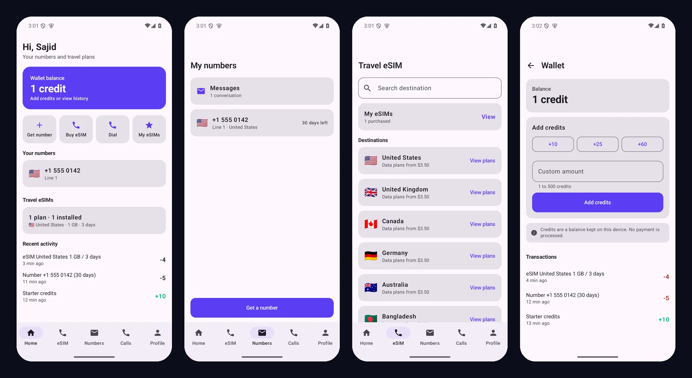
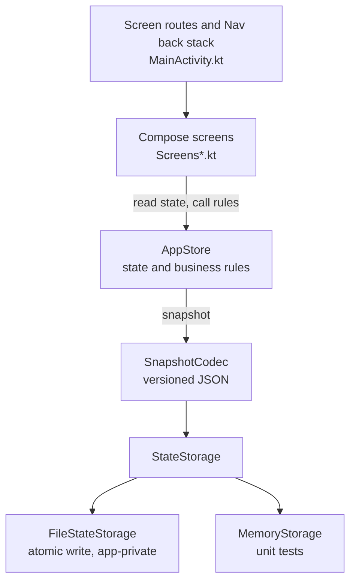
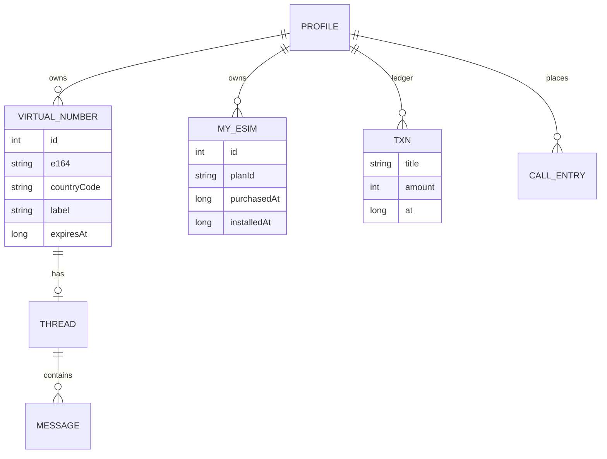

<div align="center">



<p><code>A native Android app for virtual numbers and travel eSIM plans, paid for from one credits wallet</code></p>

<p>
<a href="https://github.com/Saji-d/numa-sim-wallet"></a>


</p>

<p>


</p>

<p>
<a href="#-overview">Overview</a> · <a href="#-highlights">Highlights</a> · <a href="#-preview">Preview</a> · <a href="#-architecture">Architecture</a> · <a href="#-tech-stack">Tech Stack</a> · <a href="#-getting-started">Getting Started</a> · <a href="#-project-structure">Structure</a> · <a href="#-author">Author</a>
</p>

</div>


## ◈ Overview

Numa brings the everyday tasks of a second-number and travel-data app into one place. Pick a number in another country, keep a conversation per number, place calls from a dialer, buy a data plan for an upcoming trip and pay for all of it from a single credits wallet.

It is an offline-first client with real business rules. Credit checks, 30-day number terms with renewal and eSIM validity that starts when a plan is marked installed are enforced in one store, and the whole state is saved on the device so the app resumes where it was left.

> **Honest scope.** Numa has no backend and no provider integrations. Numbers, plans and credits are records kept on the device, and nothing is provisioned or charged. Messages are stored locally and are not delivered over a network. Calls end on a "not connected" screen and are logged as attempts. eSIM purchases show install steps but issue no real profile. Settings lists voice, SMS, eSIM provisioning and payments as Not connected. There are no automated UI tests yet.


## ◈ Highlights

<table width="100%">
<tr>
<td width="33%" valign="top">

**Virtual numbers**<br/>
Search eight countries by name or dial code, pay with credits, then rename, renew or release a number. Each has a 30-day term with a live countdown.

</td>
<td width="33%" valign="top">

**Messaging**<br/>
One conversation per number with unread state, relative timestamps, a 1,000 character limit and delete with confirmation.

</td>
<td width="33%" valign="top">

**Dialer and history**<br/>
Keypad with caller-ID selection, number validation, long-press shortcuts, redial and clear history.

</td>
</tr>
<tr>
<td width="33%" valign="top">

**Travel eSIM**<br/>
Compare plans by data, validity and price in USD and credits, with a balance-after-purchase preview and install steps.

</td>
<td width="33%" valign="top">

**Install lifecycle**<br/>
Marking a plan installed starts its validity countdown in My eSIMs, so status reads Not installed, Installed with days left, or Expired.

</td>
<td width="33%" valign="top">

**Credits wallet**<br/>
Starter credits, quick-add amounts and a validated custom amount from 1 to 500, with a signed ledger of every spend and top-up.

</td>
</tr>
<tr>
<td width="33%" valign="top">

**Persistence**<br/>
State is written as versioned JSON after every change. Writes are atomic, and a corrupt or unknown-version file falls back to a clean start.

</td>
<td width="33%" valign="top">

**Validated rules**<br/>
Purchases, renewals, top-ups and messages are checked in the store, which returns a user-facing error that screens show inline.

</td>
<td width="33%" valign="top">

**Settings**<br/>
System, light and dark theme, notification preferences, profile editing, sign out that keeps data and a confirmed delete-all-data.

</td>
</tr>
</table>


## ◈ Preview

<div align="center">

</div>

Captured from the debug build on an Android emulator. The screen map and flows are in [`docs/SCREENS.md`](docs/SCREENS.md).


## ◈ Architecture

Numa is a single-module, single-activity app. Screens are Compose functions, and all state and business rules live in one store behind a small storage interface. There is no DI framework, navigation library or database dependency.





`AppStore` keeps its state as Compose snapshot state, so screens recompose automatically. Every rule method (`buyNumber`, `renewNumber`, `send`, `buyEsim`, `addCredits` and the rest) validates its input and returns `null` on success or an error string. Lists are exposed as immutable copies and the clock is injectable for tests. The `StateStorage` interface is the seam for a Room database or a remote source later.

Navigation uses a sealed `Screen` interface and a `Nav` wrapper over a `SnapshotStateList` back stack. The five tabs reset the stack, other routes push, and system back is handled with `BackHandler`. There are no ViewModels yet because the store is process-scoped and screen state is trivial. They become worthwhile once data loads asynchronously from a backend.


## ◈ Tech Stack

| Layer | Technologies | Purpose |
|---|---|---|
| Language | Kotlin 2.1.0, JDK 17 | App and tests |
| UI | Jetpack Compose (BOM 2024.09.00), Material 3 | Screens, theming and shared components |
| State | Compose snapshot state | Reactive UI state held in `AppStore` |
| Persistence | `org.json`, atomic file writes | Versioned JSON snapshot in app-private storage |
| Navigation | Sealed `Screen` routes, custom back stack | Tabs reset the stack, other screens push |
| Testing | JUnit 4 | Store rules, persistence round trips, formatting |
| Build | Gradle 8.11.1, AGP 8.7.3, minSdk 26, compileSdk 35 | Debug APK, unit tests and lint |


## ◈ Getting Started

### Build the app

**Prerequisites:** Android Studio or the Android SDK with platform 35, and a JDK 17 toolchain. Point Gradle at the SDK with a git-ignored `local.properties`:

```properties
sdk.dir=C\:/path/to/android-sdk
```

No API keys or other configuration are required.

```bash
git clone https://github.com/Saji-d/numa-sim-wallet.git
cd numa-sim-wallet
./gradlew assembleDebug      # use gradlew.bat on Windows
adb install -r app/build/outputs/apk/debug/app-debug.apk
adb shell am start -n com.sajid.numa/.MainActivity
```

Or open the folder in Android Studio and press **Run**.

### Run the tests

```bash
./gradlew testDebugUnitTest  # 63 JVM unit tests, no device needed
./gradlew lintDebug          # Android lint
```

All 63 unit tests pass and lint reports 0 errors. The tests cover the store rules, persistence round trips including corrupt files, and the formatting and validation helpers. The UI flows were exercised by hand on an emulator (profile, buying a number, messaging, dialer, eSIM purchase and install, wallet, theme and restart persistence). There are no automated UI tests and no physical-device testing yet.


## ◈ Project Structure

The app is one module. Domain models, rules and persistence sit beside the Compose screens, and the unit tests mirror them.

<details>
<summary>Open the folder map</summary>

```text
app/src/main/java/com/sajid/numa/
├── MainActivity.kt      # Screen routes, Nav back stack, bottom bar, router
├── NumaApp.kt           # Application class, creates the file-backed AppStore
├── AppStore.kt          # State and business rules (single source of truth)
├── Data.kt              # Domain models, constants, static catalogue
├── Persistence.kt       # StateStorage, FileStateStorage, MemoryStorage, SnapshotCodec
├── Format.kt            # Relative dates, durations, money, email and dial validation
├── Theme.kt             # Material 3 theme and shared components
├── ScreensHome.kt       # Welcome, SignIn, Home, Profile, Settings
├── ScreensNumbers.kt    # Numbers, GetNumber, PickNumber, NumberDetail, Messages, Thread
├── ScreensCalls.kt      # Calls, Dialer, InCall
└── ScreensEsim.kt       # Esim, EsimCountry, EsimPlanDetail, MyEsims, Wallet

app/src/test/java/com/sajid/numa/   # AppStoreTest, SnapshotCodecTest, FormatTest
assets/                             # README banner and divider
docs/                               # SCREENS.md, IMPLEMENTATION_REPORT.md, preview.webp
```

</details>


## ◈ Author

**Sajidur Rahman Sajid**: Full-Stack Developer and AI engineer from Dhaka.<br>
BSc in CSE at American International University-Bangladesh (AIUB).

<p>
  <a href="https://www.sajidur.me"></a>
  <a href="https://www.linkedin.com/in/sajidur-rahman-sajid/"></a>
  <a href="https://github.com/Saji-d"></a>
  <a href="mailto:sajidsajidurrahman99@gmail.com"></a>
</p>

<sub>No licence file is included, so all rights are reserved.</sub>
